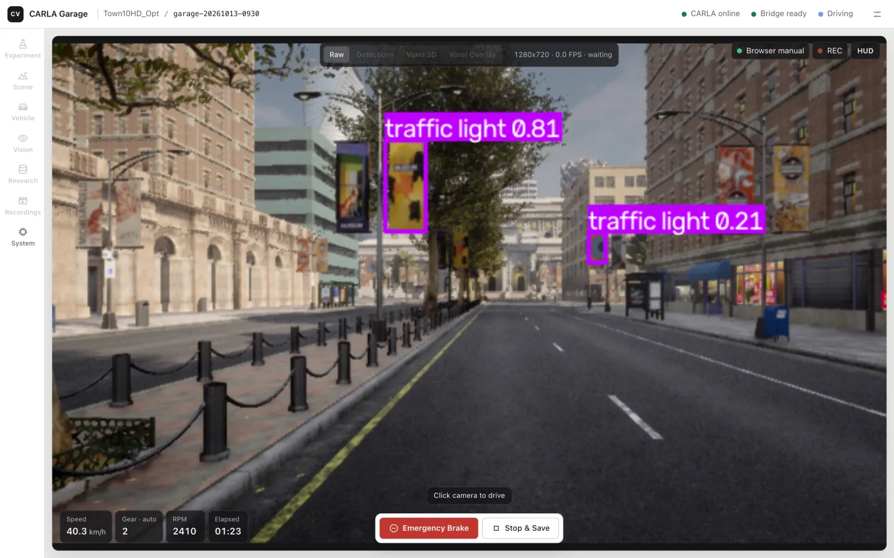
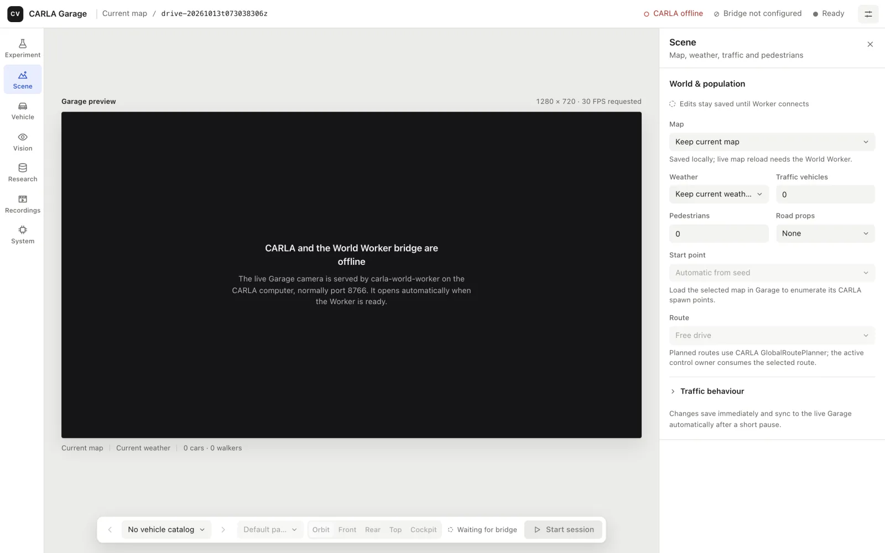
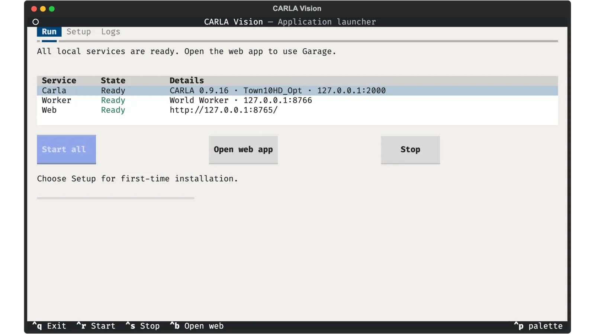
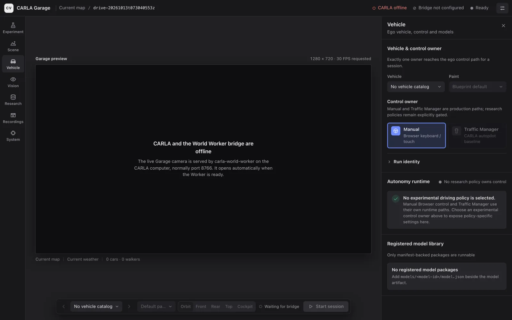
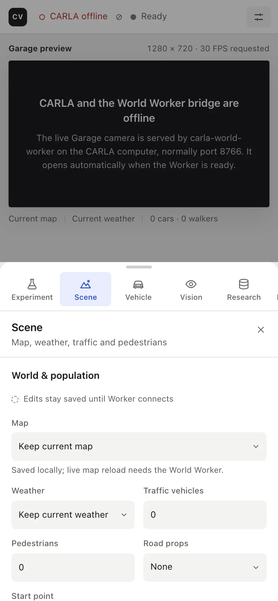
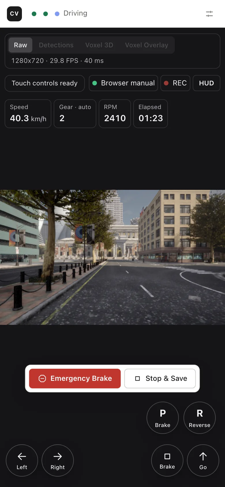

# کنسول پژوهشی بینایی CARLA

**فارسی** · [English](README.md)

یک کنسول پژوهشی محلی برای CARLA 0.9.16: گاراژ تمام‌صفحه، رانندگی دستی و با Traffic Manager، تشخیص بینایی زنده با یک دوربین، ضبط، و فرایندهای تکرارپذیر داده و مدل، بدون این‌که پژوهشگر برای هر جلسه کد پایتون بنویسد.

<p align="center"></p>

این مخزن یک ابزار پژوهشی برای شبکه‌ی محلی است، نه یک سرویس اینترنتی یا چندکاربره. سرور مرورگر عمداً فقط روی loopback (همین کامپیوتر) گوش می‌دهد.

## شروع کنید

**[راهنمای کاربر](docs/user_guide_fa.md)** نصب، اولین اجرا، رانندگی و ضبط‌ها را قدم‌به‌قدم و بر اساس سیستم‌عامل شما توضیح می‌دهد:

| ویندوز | لینوکس | مک |
| --- | --- | --- |
| [CARLA + ورکر + وب‌اپ](docs/user_guide_fa.md#ویندوز) | [CARLA + ورکر + وب‌اپ](docs/user_guide_fa.md#لینوکس) | [وب‌اپ متصل به یک کامپیوتر CARLA](docs/user_guide_fa.md#مک) |

<table>
  <tr>
    <td width="50%"><br><sub>گاراژ: دوربین در وسط، بخش‌ها در چپ، تنظیمات در راست</sub></td>
    <td width="50%"><br><sub>لانچر: نصب، روشن و خاموش کردن CARLA، ورکر و وب‌اپ</sub></td>
  </tr>
  <tr>
    <td><br><sub>تم تیره‌ی خودکار</sub></td>
    <td align="center"> <br><sub>گوشی و تبلت: برگه‌ی تنظیمات و رانندگی لمسی</sub></td>
  </tr>
</table>

<sub>اسکرین‌شات‌ها کنسول را بدون اتصال به شبیه‌ساز نشان می‌دهند، به‌جز تصاویر رانندگی که یک فریم ضبط‌شده از CARLA را بازپخش می‌کنند.</sub>

## نصب سریع

| کامپیوتر | چه چیزی نصب می‌شود |
| --- | --- |
| ویندوز / لینوکس x86-64 | سرور CARLA، ورکر، وب‌اپ و لانچر تمام‌صفحه روی همان کامپیوتر |
| مک Apple Silicon، macOS 14 به بالا | وب‌اپ، ضبط و بینایی، متصل به یک میزبان CARLA ویندوز/لینوکس |
| مک Intel، macOS 14 به بالا | وب‌اپ و ضبط؛ فایل‌های مدل بازیابی می‌شوند، اما اجرای مدل به یک میزبان بینایی پشتیبانی‌شده نیاز دارد |

نصب‌کننده برنامه، کنسول وب کامپایل‌شده، هر ده فایل وزن مدل و نمونه‌های تاریخی را بازیابی می‌کند و یک محیط پایتون خصوصی و رمزگذار ویدیو آماده می‌کند. نیازی به پایتون، Node، Git یا Git LFS از پیش نصب‌شده نیست.

**ویندوز (PowerShell):**

```powershell
curl.exe -fL https://raw.githubusercontent.com/koolfox/carla-local-autonomy/refs/heads/main/deploy/restore/restore.ps1 -o restore.ps1
powershell.exe -NoProfile -ExecutionPolicy Bypass -File .\restore.ps1 --destination "C:\CARLA-Vision" --role local --download-carla
cd C:\CARLA-Vision
.\deploy\desktop\CARLA-Vision.cmd
```

**مک (Terminal):**

```bash
curl -fsSL https://raw.githubusercontent.com/koolfox/carla-local-autonomy/refs/heads/main/restore.sh -o restore.sh
sh restore.sh --destination "$HOME/CARLA-Vision" --role web
cd "$HOME/CARLA-Vision"
./CARLA-Vision.command
```

**لینوکس x86-64 (Terminal):**

```bash
curl -fsSL https://raw.githubusercontent.com/koolfox/carla-local-autonomy/refs/heads/main/restore.sh -o restore.sh
sh restore.sh --destination "$HOME/CARLA-Vision" --role local --download-carla
cd "$HOME/CARLA-Vision"
sh deploy/desktop/launch.sh
```

اگر CARLA از قبل نصب است، به‌جای `--download-carla` از `--carla-root` با مسیر پوشه‌ی CARLA استفاده کنید. یک پوشه‌ی خالی برای مقصد انتخاب کنید؛ نصب نیمه‌کاره را می‌توان با `--resume` ادامه داد. نصب‌کننده سرویس‌ها را خودکار روشن نمی‌کند و درایور گرافیک نصب نمی‌کند؛ CARLA به سخت‌افزار گرافیک مناسب و فضای دیسک کافی نیاز دارد.

این نصب‌کننده‌ها پیش‌نمایش هستند: بررسی‌های سورس و بازیابی موفق‌اند، اما نصب کامل روی سیستم تازه، اجرای مدل و تست با CARLA واقعی هنوز در انتظار است.

## استفاده‌ی روزانه

لانچر روی هر سه سیستم تب‌های **Run**، **Setup** و **Logs** دارد.

- **ویندوز / لینوکس (حالت محلی):** در Setup، دکمه‌ی **Install / Repair** همه‌چیز را آماده می‌کند. در Run، دکمه‌ی **Start all** سرور CARLA، ورکر و وب‌اپ را روشن می‌کند و **Stop** صحنه را پاک‌سازی و فقط چیزهایی را که خودش روشن کرده خاموش می‌کند. سرور CARLA‌ای که از بیرون روشن شده حفظ می‌شود.
- **مک / لینوکس / ویندوز (فقط وب‌اپ):** در Setup گزینه‌ی Web app را انتخاب کنید، فایل اتصالِ میزبان را وارد کنید و **Check connection** را بزنید. در Run، **Start web app** و **Stop** فقط وب‌سرور محلی را مدیریت می‌کنند. ضبط‌های ذخیره‌شده بدون اتصال هم قابل مشاهده‌اند.

## بررسی با CARLA واقعی

با یک کلیک: در وب‌اپ **System ← Live check**، یا در لانچر دکمه‌ی **Live check** در تب Run (دو بار بزنید). نقشه‌ی Town10HD را بارگذاری می‌کند، یک خودروی آزمایشی را می‌راند، متوقف و پاک‌سازی می‌کند و گزارش را در `runs/` ذخیره می‌کند.

## امکانات

- گاراژ واقعی CARLA با انتخاب خودرو، رنگ، نقشه، آب‌وهوا، ترافیک، عابر، اشیای جاده و زاویه‌های دوربین؛
- رانندگی با کیبورد و لمسی، با ترمز خودکار هنگام قطع ورودی و ترمز اضطراری؛
- رانندگی خودکار با Traffic Manager خودِ CARLA و تحویل فوری کنترل به راننده؛
- نمایش تشخیص اشیا با RT-DETR، YOLO یا آشکارساز سفارشی؛
- ضبط ویدیوی خام و حاشیه‌نویسی‌شده، فرمان‌ها، تشخیص‌ها، رویدادها، خلاصه‌ها و مانیفست با checksum؛
- پیدا کردن خودکار شبیه‌ساز CARLA در شبکه‌ی محلی؛
- مرور و راستی‌آزمایی اجراهای ذخیره‌شده.

BehaviorAgent، رانندگی تقلیدی (imitation)، برنامه‌ریزی وکسل و کارهای پژوهشی حلقه‌بسته آزمایشی‌اند و به‌طور پیش‌فرض خاموش‌اند. Traffic Manager یک قابلیت شبیه‌ساز CARLA است و به‌عنوان مدلی که این پروژه ساخته معرفی نمی‌شود.

## معماری

اجرا روی یک کامپیوتر:

```text
Full-screen TUI → CARLA 0.9.16 :2000
                → World Worker :8766
                → web console :8765 → local browser
```

اجرا روی دو کامپیوتر:

```text
Windows CARLA host                         Research computer
------------------                        -----------------
CARLA 0.9.16 :2000  <-------------------> Garage / Drive server :8765
World Worker :8766  <-------------------> browser + vision runtime
official PythonAPI                         RT-DETR / YOLO / recorder
```

ورکر عمداً سبک است و فقط کارهای PythonAPI رسمی را انجام می‌دهد: بارگذاری نقشه، آب‌وهوا، Traffic Manager، عابرها، اشیای جاده و ارسال تصویر دوربین. کامپیوتر پژوهشی رابط کاربری، اجرای مدل، ضبط ویدیو، داده‌ها و گزارش‌ها را بر عهده دارد.

## خروجی‌ها

هر رانندگیِ ذخیره‌شده در `runs/<run-id>/` نوشته می‌شود و ممکن است شامل این فایل‌ها باشد:

```text
config.json
controls.jsonl
detections.jsonl
events.jsonl
human_markers.jsonl
raw.mp4
annotated.mp4
summary.json
manifest.json
```

داده‌ها، اجراها، مدل‌های تازه دانلودشده، گزارش‌ها و جلسه‌های اپراتور در Git ذخیره نمی‌شوند.

## اطلاعات بیشتر

بخش‌های فنی (به انگلیسی) در [README انگلیسی](README.md) هستند: کلون با مدل‌های همراه، اجرای ورکر ویندوز، کارایی دوربین از راه دور، فرایندهای پژوهشی، آشکارساز سفارشی، راستی‌آزمایی و معیارهای پذیرش.

- مشارکت در پروژه: [CONTRIBUTING.md](CONTRIBUTING.md) و [نقشه‌ی توسعه‌دهندگان](docs/README.md)
- عامل‌های هوش مصنوعی: [AGENTS.md](AGENTS.md)
- [منشور رفتاری](CODE_OF_CONDUCT.md)
