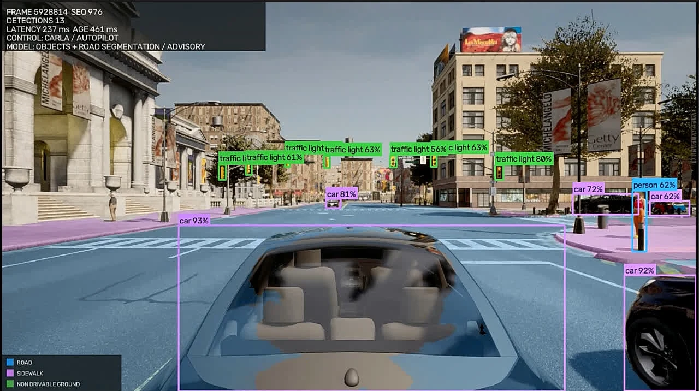

# CARLA Vision Research Console

**English** · [فارسی](README.fa.md)

A local research console for CARLA 0.9.16. It provides a full-screen Garage,
manual and Traffic Manager driving, live monocular vision inference, recording,
and reproducible dataset/model workflows without requiring researchers to write
Python for every session.

<p align="center"><br><sub>A recorded CARLA session: Traffic Manager drives while object detection and road segmentation run as advisory overlays.</sub></p>

This repository is a LAN research tool, not an internet-facing or multi-user
service. The browser server deliberately binds to loopback only.

## Get started

The **[user guide](docs/user_guide.md)** ([فارسی](docs/user_guide_fa.md)) walks
through installation, first start, driving and recordings step by step for your
operating system:

| Windows | Linux | macOS |
| --- | --- | --- |
| [CARLA + Worker + web app](docs/user_guide.md#windows) | [CARLA + Worker + web app](docs/user_guide.md#linux) | [Web app connected to a CARLA computer](docs/user_guide.md#macos) |

<table>
  <tr>
    <td width="50%"><br><sub>Garage: camera in the middle, sections on the left, settings on the right</sub></td>
    <td width="50%"><br><sub>Launcher: install, start and stop CARLA, Worker and web app</sub></td>
  </tr>
  <tr>
    <td><br><sub>Automatic dark theme</sub></td>
    <td align="center"> <br><sub>Phone and tablet: settings sheet and touch driving</sub></td>
  </tr>
</table>

<sub>The gallery shows the console without a simulator connected; the phone
driving view replays a raw frame recorded from CARLA.</sub>

## Quick start with curl

The bootstrap on `main` restores the application, compiled web console, all ten
model weights and historical samples, then prepares a private Python environment
and recording encoder. Preinstalled Python, Node, Git and Git LFS are not needed
for this source-archive installation.

| Computer | Installation profile |
| --- | --- |
| Windows / Linux x86-64 | CARLA server, Worker, web app and full-screen TUI on the same computer |
| Apple Silicon, macOS 14+ | Web app, recording and vision connected to a Windows/Linux CARLA host |
| Intel Mac, macOS 14+ | Web app and recording; model files are restored, inference needs a supported vision host |

### Windows (PowerShell)

```powershell
curl.exe -fL https://raw.githubusercontent.com/koolfox/carla-local-autonomy/refs/heads/main/deploy/restore/restore.ps1 -o restore.ps1
powershell.exe -NoProfile -ExecutionPolicy Bypass -File .\restore.ps1 --destination "C:\CARLA-Vision" --role local --download-carla
cd C:\CARLA-Vision
.\deploy\desktop\CARLA-Vision.cmd
```

If CARLA 0.9.16 is already installed, replace `--download-carla` with
`--carla-root "C:\CARLA_0.9.16"`. In the TUI, inspect **Setup**, then choose
**Run → Start all** to start CARLA, the Worker and the web app.

### macOS (Terminal)

```bash
curl -fsSL https://raw.githubusercontent.com/koolfox/carla-local-autonomy/refs/heads/main/restore.sh -o restore.sh
sh restore.sh --destination "$HOME/CARLA-Vision" --role web
cd "$HOME/CARLA-Vision"
./CARLA-Vision.command
```

macOS runs the web app; the CARLA server and Worker run on Windows/Linux. A
remote Worker must listen on its LAN address; the same-computer TUI defaults
to loopback. In the host TUI enable Worker sharing, then export a private connection
file. Import it in the Mac TUI, use **Check connection**, then **Start web app**.
See the [TUI setup guide](docs/desktop_launcher.md).

### Linux x86-64 (Terminal)

```bash
curl -fsSL https://raw.githubusercontent.com/koolfox/carla-local-autonomy/refs/heads/main/restore.sh -o restore.sh
sh restore.sh --destination "$HOME/CARLA-Vision" --role local --download-carla
cd "$HOME/CARLA-Vision"
sh deploy/desktop/launch.sh
```

Use a new/empty destination. A partial restore can be retried with `--resume`.
Setup does not start services automatically or install graphics drivers; CARLA
requires suitable graphics hardware/drivers and enough disk space. The
[recovery guide](docs/restore_project.md) explains existing-server paths,
optional profiles and importing a private backup. Keep private backups outside
the checkout: GitHub does not contain local credentials or private sessions.

These are installer previews. Source, payload and recovery-contract checks pass;
full fresh-machine installation, native Windows/Linux terminal rendering,
inference and live CARLA acceptance remain pending. Headless TUI interaction
checks cover web-only mode without CARLA.

## Run everything on the CARLA computer

The new **full-screen launcher preview** targets Windows x86-64 first and Linux
x86-64 alongside it. It prepares a private Python 3.12 environment, installs
locked vision dependencies and a recording encoder, verifies/downloads the
bundled models, and coordinates CARLA, Worker and the existing web console.

Download the [Windows setup ZIP](installers/CARLA-Vision-setup-preview.zip) or
[Linux setup archive](installers/CARLA-Vision-setup-preview.tar.gz), extract it,
and run `Install.cmd` or `sh install.sh`. In the TUI's **Setup** tab, choose the
installed CARLA 0.9.16 folder and **Install / Repair**, then **Start all** from
**Run**. Setup can also download the official CARLA package when requested.
A desktop/applications-menu shortcut provides daily startup.

From a clone, run `deploy\desktop\Install.cmd` on Windows, or
`sh deploy/desktop/install.sh` on Linux. No Node build is needed for normal use.
See the [same-computer setup guide](docs/desktop_launcher.md) for paths, CLI
commands and recovery. The setup archives retain their recorded source revision;
use the curl bootstrap above for the latest `main`. Archive integrity does not
establish runtime acceptance.

New contributors should start with the
[`developer navigation hub`](docs/README.md): find a feature, its owner, and
its first test without reading the whole codebase. Branch/PR rules and the current
source map are documented in [`CONTRIBUTING.md`](CONTRIBUTING.md) and
[`docs/project_structure.md`](docs/project_structure.md). AI coding agents
start with [`AGENTS.md`](AGENTS.md). Participation follows the
[Code of Conduct](CODE_OF_CONDUCT.md).

## Product boundary

The production surface contains:

- a real CARLA Garage with vehicle, paint, map, weather, traffic, pedestrians,
  props, and camera views;
- keyboard and touch driving with deadman braking and emergency stop;
- optional CARLA Traffic Manager autopilot with immediate manual takeover;
- RT-DETR, YOLO, or custom detector overlays;
- raw and annotated video, controls, detections, events, summaries, and
  checksum manifests;
- LAN discovery for the CARLA simulator; and
- saved-run inspection and verification.

BehaviorAgent actuation, imitation driving, voxel planning, and closed-loop
research jobs are experimental. They are disabled by default and require the
explicit `--enable-experimental` server flag. CARLA Traffic Manager autopilot
is a simulator feature and is not presented as a model developed by this
project.

## Watch saved recordings

Open **Recordings** in the left rail to search saved runs, switch between original
camera and recorded overlays, and play them with Video.js. The player includes
seeking, five-second skip buttons, playback speed, and fullscreen. Expand **Run
files** to download the original artifacts; browsing does not verify their integrity.

New recordings (raw, overlays, voxel, and dataset replay) are encoded directly as
**H.264 MP4** with `yuv420p` and fast-start indexing. The bootstrap installs a
private FFmpeg encoder: the TUI adds it to `PATH`, and the macOS command above
does the same for direct web-app startup. For a manual installation, install
FFmpeg with `libx264` on the recording/WebUI computer (`brew install ffmpeg`
on macOS), then restart the WebUI. No subsequent conversion is needed.
Lossless dataset images and the live MJPEG feed are unchanged.

Some older MP4 files use a codec browsers cannot decode. **Prepare playable copy**
creates a temporary H.264 version using that FFmpeg encoder on the WebUI computer.
Conversion runs in the background, one at a time;
long recordings can take longer. Copies are reused until the WebUI stops and never
replace the original recording or change its evidence hashes. No CARLA or Windows
World Worker update is required for playback.

## Architecture

Same-computer operation uses this local topology:

```text
Full-screen TUI → CARLA 0.9.16 :2000
                → World Worker :8766
                → web console :8765 → local browser
```

The established two-computer topology is also supported:

```text
Windows CARLA host                         Research computer
------------------                        -----------------
CARLA 0.9.16 :2000  <-------------------> Garage / Drive server :8765
World Worker :8766  <-------------------> browser + vision runtime
official PythonAPI                         RT-DETR / YOLO / recorder
```

The Windows World Worker is intentionally thin. It owns official-PythonAPI
operations such as map reload, weather, Traffic Manager, pedestrians, props,
and the persistent in-memory MJPEG relay. A dedicated split-host Worker can use
a lean environment. The same-computer installer instead shares the prepared
vision environment with the web app.

The research computer owns the UI, detector inference, video recording,
artifacts, datasets, and reports.

## Clone with the bundled models

For automatic restoration and dependency setup, use `Restore.cmd` on Windows
or `sh restore.sh` on macOS/Linux. The [recovery guide](docs/restore_project.md)
covers same-computer CARLA on Windows/Linux, the Mac web-app profile and importing
the private backup saved outside this checkout. Restoration includes all
published model weights and historical sample files. macOS does not run a local
CARLA server through this tool.

Install [Git LFS](https://docs.github.com/en/repositories/working-with-files/managing-large-files/installing-git-large-file-storage)
before cloning. The checkout includes ten model-weight files (about 699 MiB),
matching DeiT class tables and pinned Hugging Face processor/configuration files:

```bash
git lfs install
git clone https://github.com/koolfox/carla-local-autonomy.git
cd carla-local-autonomy
git lfs pull
```

The default `main` branch includes the model/sample, launcher and recovery work.
Existing checkouts can update `main` and run `git lfs pull`.

See [the bundled-model inventory](models/README.md) for exact paths, hashes,
upstream notices and offline model-cache settings. A clone without Git LFS, or
with LFS downloads disabled, leaves small pointer files in place of weights.
Run commands from the repository root so the default workspace resolves the
bundled `models/` directory. The [new-environment guide](docs/clone_setup.md)
covers dependencies, local connection settings and the separate CARLA host.

## Daily use through the TUI

Open **CARLA Vision** on Windows, `CARLA-Vision.command` on macOS, or the
applications-menu entry / `deploy/desktop/launch.sh` on Linux. The same TUI has
**Run**, **Setup** and **Logs** tabs on all three systems.

- **Windows / Linux local mode:** Setup → Install / Repair prepares the SDK,
  camera dependencies, models and encoder. Run → Start all starts CARLA,
  authenticated Worker and web app. Stop cleans up the scene and stops owned
  processes; a CARLA server started externally is preserved.
- **macOS / Linux / Windows web-only mode:** choose Web app in Setup, import
  the host's connection file or enter the host/URL/token, then Check connection.
  Run → Start web app / Stop manages the local web server. A remote CARLA server
  and Worker are preserved. Saved recordings can be browsed with no connection.

## Run the Windows World Worker

For same-computer use, the TUI installs and starts the Worker automatically;
no Python commands or environment activation are required. A remote Mac/Linux
client needs the host's **Share Worker with another computer on this LAN** option.
Select the host's LAN address, then **Allow LAN in Windows Firewall…** if needed
(Windows asks for administrator permission). The rule is scoped to the local
subnet on Private networks. Export the connection file and import it in the
client TUI. The file contains a credential; keep it private.

If native libraries cannot load, use **Install CARLA prerequisites…** to run the
runtime installer bundled with the selected Windows CARLA package, then retry
**Install / Repair**. Windows may require a restart. Initial setup needs internet;
CARLA still needs suitable graphics hardware/drivers. See the
[full setup and troubleshooting guide](docs/desktop_launcher.md).

Manual package commands, `.env.local` setup and standalone Worker commands are
in the [developer/manual guide](docs/manual_setup.md). No manual Python command
is part of the ordinary TUI workflow.

## Remote camera performance

The default release profile is `1280 x 720 @ 30 FPS`. `1280 x 720 @ 60 FPS` is
selectable, but it remains a live-unverified candidate until the real Windows
CARLA host and LAN pass the fixed acceptance matrix. Camera frames are JPEG
encoded in memory beside CARLA and forwarded through persistent MJPEG streams;
the normal browser path does not write per-frame temporary files or issue one
HTTP request per frame.

The live MJPEG feed is for driving feedback. Training data must come from the
synchronized native dataset-capture workflow; dropped/newest-only preview frames
and review MP4s are not canonical training samples. See
[docs/realtime_streaming.md](docs/realtime_streaming.md) for exact profiles,
measurements, hard pass/fail thresholds, and the H.264/WebRTC fallback decision.

For synchronized multi-camera teacher collection initiated from the Mac, see
[native research jobs](docs/native_research_jobs.md). Use **Research → Record
teacher dataset**: the normal Worker runs the existing collector on Windows;
the WebUI retrieves the verified dataset and adds review videos to Recordings.
No separate service, task export, or extra Worker startup flags are needed.

## Garage and Drive

The normal operator journey is:

1. choose the vehicle and paint;
2. select map, weather, traffic, pedestrians, props, and starting mode;
3. inspect the live CARLA Garage and camera angle;
4. start the drive;
5. use keyboard or touch controls, optionally with detector overlays;
6. mark useful human-observed moments; and
7. end and save the run.

Keyboard controls:

```text
W / Up       throttle
S / Down     brake
A / Left     steer left
D / Right    steer right
Space        handbrake
Shift + W    reverse transition
```

Browser input, camera freshness, and the actuator watchdog are independent
safety gates. Stale input or camera loss applies service braking. Model overlay
output never blends silently with human input.

## Outputs

Each retained drive is written under `runs/<run-id>/` and may include:

```text
config.json
controls.jsonl
detections.jsonl
events.jsonl
human_markers.jsonl
raw.mp4
annotated.mp4
summary.json
manifest.json
```

Generated datasets, runs, new model downloads, reports, bundles, native kits, and operator
sessions are ignored by Git. The explicitly curated [historical samples](samples/README.md)
contain five short recordings, camera images, a three-frame labelled dataset,
report snapshots and DeiT class tables, with a byte-size and SHA-256 inventory.
These are historical development examples; fresh live-CARLA acceptance is pending.
The [bundled models](models/README.md) are a separate, deliberately published
Git LFS asset set. Keep new runtime output in the ignored roots; additions to
the model bundle require an explicit ignore-rule and inventory update. Use
releases or an external artifact store for large datasets and generated bundles.

## Research workflows

The Research surface retains the useful artifact-producing pipeline:

- synchronized RGB plus privileged instance-label collection;
- canonical COCO and derived YOLO exports;
- automated dataset QA;
- deterministic scenario planning and native capture;
- detector training for RT-DETR, YOLO, or a custom adapter;
- evaluation, paired replay, threshold selection, and failure review;
- analysis, plots, reports, model packaging, and reproduction bundles; and
- manifest/checksum verification.

Install the `research` profile before launching compute-heavy jobs. Passing a
unit test or dry run proves the software contract, not model quality. A model
claim requires a retained dataset, checkpoint, evaluation, and live acceptance
run.

## Experimental research

To expose the retained BehaviorAgent/imitation/voxel/closed-loop endpoints:

```bash
uv run --no-sync carla-operator-ui \
  --carla-host auto \
  --world-worker-url auto \
  --enable-experimental \
  --open-browser
```

These paths are not production capabilities. In particular, the current
imitation and voxel-control contracts consume simulator-derived ego speed and
therefore do not satisfy the repository's strict monocular-only policy claim.

## Detector adapter

The built-in adapter supports Ultralytics RT-DETR and YOLO. A custom detector
implements the small `Detector` protocol: metadata, `infer(image_bgr)`, and
`close()`. The core runtime supplies only a copied `uint8 HxWx3` image to the
detector.

## Verification

Run the production checks:

```bash
uv run ruff check carla_vision tests restore_project.py
python3 -B restore_project.py --plan --role web
node --check carla_vision/operator/static/app.js
uv run pytest -q
cd web
npm ci --no-audit --no-fund
npm run check
npm test
npm run build
cd ..
git status --porcelain --untracked-files=all -- carla_vision/operator/console_static
```

The final `git status` command must be empty when the committed Svelte source
and deployable bundle are synchronized. CI has six checks: the lean Operator
profile, the SvelteKit console, the complete research/experimental suite, and
recovery contracts on Windows, Linux and macOS. The merged integration passed
[main CI](https://github.com/koolfox/carla-local-autonomy/actions/runs/38260870609).
Live CARLA acceptance remains a separate gate because unit tests use
fake RPC/PythonAPI objects and do not prove simulator behavior. Run it with one
click: **System → Live check** in the web app, or **Live check** in the TUI's Run
tab (press twice to confirm). It loads Town10HD, spawns a test car with five cars
and five walkers, drives it manually (and with BehaviorAgent when the CARLA
PythonAPI is installed), stops, and saves `runs/garage-acceptance-<time>.json`.
The Garage preview pauses and Drive is blocked while it runs. The CLI
`uv run carla-garage-acceptance` remains for scripted runs.

## Production acceptance gate

Before tagging a release, perform one real LAN session that verifies:

- Worker health and exact CARLA client/server version 0.9.16;
- two map transitions without losing the Worker listener;
- weather, traffic, pedestrians, and each fixed prop preset;
- Garage vehicle replacement and all camera views;
- ten minutes of manual driving and TM-autopilot takeover;
- the 720p30 remote-stream rows A-D in the real-time acceptance matrix;
- raw and annotated review recording without truncated duration;
- detector latency/FPS, source FPS, frame-age, and Worker-encode summaries; and
- `carla-verify` success on the retained run.

Detailed contracts remain in [docs/architecture.md](docs/architecture.md),
[docs/operator_ui.md](docs/operator_ui.md), and
[docs/artifact_policy.md](docs/artifact_policy.md). Remote-video acceptance is
defined in [docs/realtime_streaming.md](docs/realtime_streaming.md).
