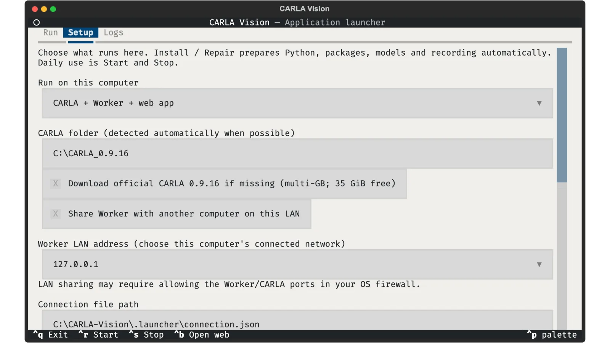
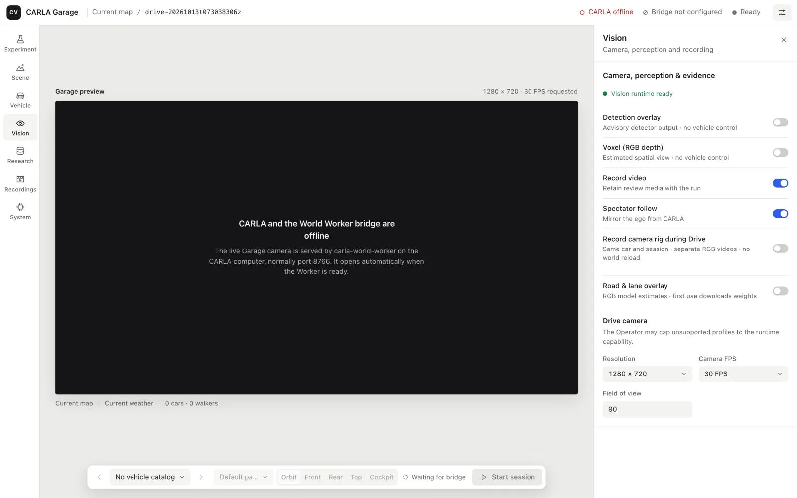

# راهنمای کاربر

**فارسی** · [English](user_guide.md)

این راهنما شما را از یک کامپیوتر تازه تا یک جلسه‌ی رانندگیِ ذخیره‌شده همراهی می‌کند. اول سیستم‌عامل خود را انتخاب کنید؛ بعد از نصب، همه‌چیز روی همه‌ی سیستم‌ها یکسان است.

| کامپیوتر شما | چه چیزی روی آن اجرا می‌شود | بخش مربوط |
| --- | --- | --- |
| ویندوز x86-64 | CARLA، ورکر (World Worker)، وب‌اپ و لانچر | [ویندوز](#ویندوز) |
| لینوکس x86-64 | CARLA، ورکر، وب‌اپ و لانچر | [لینوکس](#لینوکس) |
| مک (macOS 14 به بالا، Apple Silicon یا Intel) | فقط وب‌اپ؛ CARLA روی یک کامپیوتر ویندوز/لینوکس اجرا می‌شود | [مک](#مک) |

به CARLA 0.9.16 روی یک کامپیوتر ویندوز یا لینوکس با کارت گرافیک مناسب نیاز دارید. نصب‌کننده می‌تواند CARLA را برایتان دانلود کند.

## دو پنجره‌ای که با آن‌ها کار می‌کنید

**لانچر (TUI)** یک پنجره‌ی تمام‌صفحه‌ی ترمینال است. همه‌چیز را نصب می‌کند و بعد CARLA، ورکر و وب‌اپ را روشن و خاموش می‌کند. تب‌های آن **Run** (اجرا)، **Setup** (راه‌اندازی) و **Logs** (گزارش‌ها) هستند.

<p align="center"></p>

**وب‌اپ** کنسولی است که هر روز با آن کار می‌کنید: گاراژ، تنظیمات، رانندگی و ضبط‌ها. لانچر آن را در مرورگر شما در آدرس `http://127.0.0.1:8765/` باز می‌کند.

<p align="center"></p>

---

## ویندوز

### ۱. نصب

**PowerShell** را باز کنید و این دستورها را اجرا کنید:

```powershell
curl.exe -fL https://raw.githubusercontent.com/koolfox/carla-local-autonomy/refs/heads/main/deploy/restore/restore.ps1 -o restore.ps1
powershell.exe -NoProfile -ExecutionPolicy Bypass -File .\restore.ps1 --destination "C:\CARLA-Vision" --role local --download-carla
```

اگر CARLA 0.9.16 از قبل نصب است، به‌جای `--download-carla` بنویسید `--carla-root "C:\CARLA_0.9.16"`. یک پوشه‌ی خالی برای مقصد انتخاب کنید؛ اگر دانلود قطع شد، همان دستور را با `--resume` دوباره اجرا کنید.

### ۲. باز کردن لانچر

```powershell
cd C:\CARLA-Vision
.\deploy\desktop\CARLA-Vision.cmd
```

بعد از اولین راه‌اندازی می‌توانید از میان‌بُر **CARLA Vision** هم استفاده کنید.

### ۳. راه‌اندازی (فقط یک بار)

در تب **Setup** مطمئن شوید که گزینه‌ی **Run on this computer** روی *CARLA + Worker + web app* است و مسیر پوشه‌ی CARLA درست است، سپس **Install / Repair** را بزنید.

<p align="center"></p>

اگر CARLA نتوانست کتابخانه‌های بومی خود را بارگذاری کند، **Install CARLA prerequisites…** را بزنید (ویندوز اجازه‌ی مدیر سیستم می‌خواهد)، اگر خواسته شد ری‌استارت کنید و دوباره **Install / Repair** را اجرا کنید.

### ۴. شروع

به تب **Run** بروید و **Start all** را بزنید (یا `Ctrl+R`). وقتی CARLA، Worker و Web وضعیت **Ready** را نشان دادند، **Open web app** را بزنید (`Ctrl+B`). ادامه در بخش [کار با وب‌اپ](#کار-با-وباپ).

دکمه‌ی **Stop** (`Ctrl+S`) صحنه را پاک‌سازی می‌کند و هر چیزی را که لانچر روشن کرده خاموش می‌کند. سرور CARLA‌ای که خودتان روشن کرده‌اید روشن می‌ماند.

### استفاده از یک کامپیوتر دیگر به‌عنوان صفحه‌نمایش (اختیاری)

برای رانندگی از روی مک یا یک کامپیوتر دیگر، در **Setup** گزینه‌ی **Share Worker with another computer on this LAN** را فعال کنید، آدرس شبکه‌ی همین کامپیوتر را انتخاب کنید، **Allow LAN in Windows Firewall…** را بزنید و بعد **Export connection**. فایل خروجی را به کامپیوتر دیگر منتقل کنید؛ این فایل رمز عبور دارد، پس آن را خصوصی نگه دارید.

---

## لینوکس

### ۱. نصب

```bash
curl -fsSL https://raw.githubusercontent.com/koolfox/carla-local-autonomy/refs/heads/main/restore.sh -o restore.sh
sh restore.sh --destination "$HOME/CARLA-Vision" --role local --download-carla
```

برای استفاده از CARLA‌ی موجود، به‌جای `--download-carla` بنویسید `--carla-root /path/to/CARLA_0.9.16`. درایور گرافیک برایتان نصب نمی‌شود؛ مطمئن شوید که خود CARLA روی این سیستم اجرا می‌شود.

### ۲. باز کردن لانچر

```bash
cd "$HOME/CARLA-Vision"
sh deploy/desktop/launch.sh
```

بعد از راه‌اندازی، گزینه‌ی **CARLA Vision** در منوی برنامه‌ها همین کار را می‌کند. پنجره‌ی ترمینال حداقل ۱۰۰ × ۳۰ کاراکتر باشد.

### ۳. راه‌اندازی و شروع

مثل ویندوز: **Setup ← Install / Repair**، بعد **Run ← Start all** و **Open web app**. برای اشتراک در شبکه، فایروال توزیع شما باید پورت TCP 8766 (ورکر) و 2000 تا 2002 (CARLA) را فقط از شبکه‌ی محلی باز کند، برای مثال:

```bash
sudo ufw allow from 192.168.1.0/24 to any port 2000:2002,8766 proto tcp
```

---

## مک

مک وب‌اپ، ضبط‌ها و بینایی را اجرا می‌کند. CARLA و ورکر روی یک کامپیوتر ویندوز یا لینوکس در همان شبکه اجرا می‌شوند.

### ۱. آماده کردن کامپیوتر CARLA

روی کامپیوتر ویندوز/لینوکس، بخش مربوط به آن را در بالا دنبال کنید، گزینه‌ی **Share Worker with another computer on this LAN** را فعال کنید، **Start all** و بعد **Export connection** را بزنید. فایل اتصال را به مک منتقل کنید (AirDrop، فلش یا یک پوشه‌ی اشتراکی خصوصی).

### ۲. نصب روی مک

**Terminal** را باز کنید:

```bash
curl -fsSL https://raw.githubusercontent.com/koolfox/carla-local-autonomy/refs/heads/main/restore.sh -o restore.sh
sh restore.sh --destination "$HOME/CARLA-Vision" --role web
cd "$HOME/CARLA-Vision"
./CARLA-Vision.command
```

### ۳. اتصال و شروع

در **Setup** گزینه‌ی **Web app — connect to another CARLA computer** را انتخاب کنید، مسیر فایل اتصال را وارد کنید و **Import connection** را بزنید، بعد **Check connection**. در **Run** دکمه‌ی **Start web app** و سپس **Open web app** را بزنید.

ضبط‌های ذخیره‌شده را حتی وقتی کامپیوتر CARLA خاموش است می‌توانید روی مک ببینید. روی مک‌های Intel فایل‌های مدل بازیابی می‌شوند، اما تشخیص زنده به یک میزبان بینایی پشتیبانی‌شده نیاز دارد.

---

## کار با وب‌اپ

صفحه مثل یک ابزار طراحی کار می‌کند: دوربین زنده‌ی CARLA در وسط است، بخش‌ها در سمت چپ، تنظیمات هر بخش در سمت راست، و کارهای اصلی در نوار شناور پایین.

<p align="center"></p>

| ناحیه | کاربرد |
| --- | --- |
| نوار بالا | نقشه و شناسه‌ی اجرای فعلی، و وضعیت CARLA، پل ورکر و جلسه. **نقطه‌ی توپر** یعنی سالم یا بیکار، **حلقه** یعنی خاموش یا خطا، **حلقه‌ی خط‌خورده** یعنی پیکربندی نشده، **حلقه‌ی خط‌چین** یعنی در انتظار، **نقطه‌ی نیمه‌پر** یعنی در حال همگام‌سازی. با کلیک روی وضعیت، بخش **System** باز می‌شود. |
| ستون چپ | **Experiment** (آزمایش)، **Scene** (نقشه، آب‌وهوا، ترافیک، عابر، نقطه‌ی شروع، مسیر)، **Vehicle** (خودرو، کنترل‌کننده، مدل‌ها)، **Vision** (دوربین، تشخیص، لایه‌های جاده و وکسل، ضبط)، **Research** (پژوهش)، **Recordings** (ضبط‌ها)، **System** (سیستم). |
| پنل راست | تنظیمات بخش انتخاب‌شده. تغییرات فوراً ذخیره می‌شوند و بعد از مکثی کوتاه روی گاراژ زنده اعمال می‌شوند؛ تا وقتی همگام‌سازی تمام نشده، پنل آن را نشان می‌دهد. با دکمه‌ی بالا سمت راست می‌توانید پنل را ببندید تا دوربین بزرگ‌تر شود. |
| دوربین | نمای زنده‌ی گاراژ. برای چرخاندن بکشید و برای زوم اسکرول کنید. رزولوشن و FPS اعمال‌شده بالای آن است (اگر CARLA درخواست شما را محدود کرده باشد، نارنجی می‌شود) و نقشه، آب‌وهوا و جمعیتِ اعمال‌شده زیر آن. |
| نوار پایین | خودروی قبلی/بعدی، رنگ، زاویه‌ی دوربین (orbit، front، rear، top، cockpit) و **Start session**. |

### رانندگی

**Start session** را بزنید. دوربین کل صفحه را پر می‌کند؛ سرعت، دنده، دور موتور و زمان سپری‌شده پایین سمت چپ است، و **Emergency Brake** (ترمز اضطراری) و **Stop & Save** (توقف و ذخیره) در نوار پایین.

<p align="center"></p>

روی دوربین کلیک کنید و با کیبورد برانید:

| کلید | کار |
| --- | --- |
| `W` / `↑` | گاز |
| `S` / `↓` | ترمز |
| `A` / `←`، `D` / `→` | فرمان |
| `Space` | ترمز دستی |
| `Shift` + `W` | دنده عقب |

روی گوشی یا تبلت از دکمه‌های گرد لمسی استفاده کنید. اگر ورودی قطع شود یا دوربین متوقف شود، خودرو خودش ترمز می‌گیرد. **Stop & Save** اجرا را تمام می‌کند و آن را در `runs/<run-id>/` ذخیره می‌کند.

### گوشی و تبلت

همین برنامه روی گوشی یا تبلتِ متصل به شبکه‌ی شما هم کار می‌کند. تنظیمات به شکل یک برگه از پایین باز می‌شود (دکمه‌ی **Settings** بالا سمت راست) و دوربین بالای آن دیده می‌شود.

<p align="center">
  
  &nbsp;
  
</p>

### دیدن ضبط‌ها

در ستون چپ **Recordings** را باز کنید، اجراها را جستجو یا فیلتر کنید و پخش کنید. می‌توانید بین دوربین اصلی و لایه‌های ضبط‌شده جابه‌جا شوید و فایل‌های اصلی را از **Run files** دانلود کنید. ویدیوهای قدیمی‌تری که مرورگر پخش نمی‌کند با **Prepare playable copy** تبدیل می‌شوند؛ فایل اصلی هرگز تغییر نمی‌کند.

### حالت روشن و تیره

برنامه به‌طور خودکار از تنظیم روشن یا تیره‌ی سیستم شما پیروی می‌کند.

<p align="center"></p>

---

## رفع اشکال

| مشکل | راه‌حل |
| --- | --- |
| «CARLA and the World Worker bridge are offline» | از لانچر سرویس‌ها را روشن کنید (**Run ← Start all**)، یا روی مک اتصال را در **Setup** بررسی کنید. |
| یک سرویس در لانچر **Unavailable** است | تب **Logs** همان سرویس را ببینید. روی ویندوز **Install CARLA prerequisites…** را اجرا و سیستم را ری‌استارت کنید. |
| «Web port is occupied» | برنامه‌ی دیگری از پورت 8765 استفاده می‌کند. آن را ببندید یا در **Setup** پورت دیگری انتخاب کنید. |
| مک به ورکر وصل نمی‌شود | هر دو کامپیوتر باید در یک شبکه باشند؛ مرحله‌ی فایروال را روی کامپیوتر CARLA بررسی کنید و **Check connection** را بزنید. |
| یک ضبط پخش نمی‌شود | در **Recordings** از **Prepare playable copy** استفاده کنید. |
| «Host … is not allowed» | برنامه را از طریق `127.0.0.1` یا `localhost` باز کنید. برای دامنه‌ی عمومی، راهنمای [Cloudflare Tunnel](cloudflare_tunnel.md) را ببینید. |

جزئیات بیشتر (انگلیسی): [راهنمای لانچر](desktop_launcher.md)، [راهنمای بازیابی](restore_project.md)، [نصب دستی](manual_setup.md).

اسکرین‌شات‌ها کنسول را بدون اتصال به شبیه‌ساز نشان می‌دهند، به‌جز تصاویر رانندگی که یک فریم ضبط‌شده از CARLA (`samples/recordings/`) را بازپخش می‌کنند.
