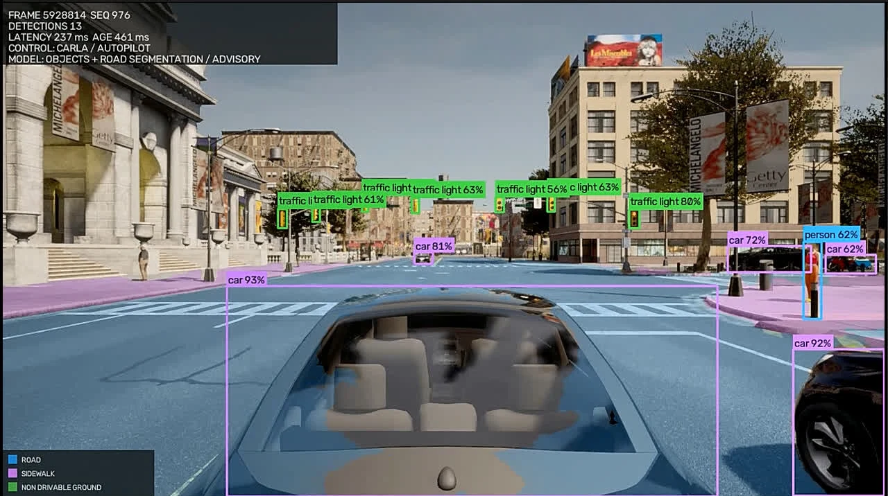
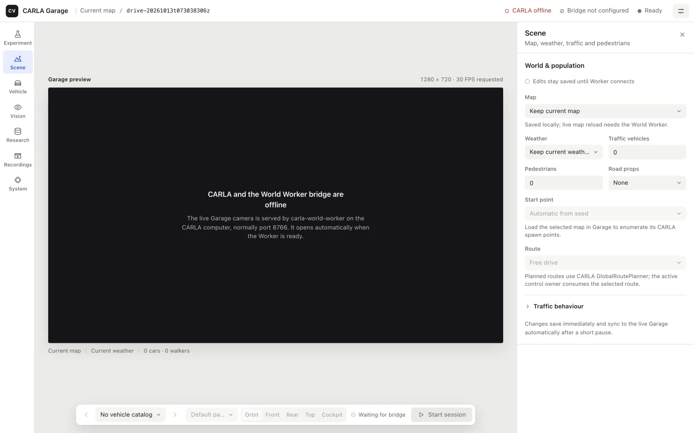

# کارگاه CARLA Vision

## امروز از چه چیزی حرف می‌زنیم؟

- یک تصویر دوربین چگونه به **مشاهدهٔ صحنه** تبدیل می‌شود؟
- نقش شبیه‌ساز، مدل، رابط کاربری و راننده چیست؟
- چه چیزی را واقعاً آزمایش کرده‌ایم و چه چیزی هنوز نیاز به شواهد دارد؟

> هدف کارگاه: شناخت مسیر یک پژوهش قابل تکرار؛ نه ادعای خودروی خودران آمادهٔ جاده.

## مسئله: دیدن، به معنی تصمیم گرفتن نیست

- دوربین مجموعه‌ای از پیکسل‌ها را در اختیار ما می‌گذارد.
- مدل می‌تواند اشیا، جاده یا عمق تخمینی را پیش‌بینی کند.
- تصمیم‌گیری و کنترل به اطلاعات زمانی، مسیر و سازوکار ایمنی هم نیاز دارند.

> پرسش: اگر عابر دیده نشود، آیا صرفِ داشتن یک مدل تشخیص برای ترمز کافی است؟

## CARLA؛ آزمایشگاه رانندگی مجازی

- شبیه‌ساز متن‌باز برای پژوهش رانندگی خودکار در محیط شهری.
- امکان تعریف خودرو، دوربین، نقشه، ترافیک و شرایط محیطی.
- تکرار یک سناریو کمک می‌کند روش‌ها را در شرایط مشخص مقایسه کنیم.

> منبع: [مقالهٔ اصلی CARLA، Dosovitskiy و همکاران، ۲۰۱۷](https://proceedings.mlr.press/v78/dosovitskiy17a.html). شبیه‌سازی جای آزمون دنیای واقعی را نمی‌گیرد.

## چه ساخته‌ایم؟

- یک کنسول پژوهشی برای تنظیم صحنه، مشاهده، ضبط و بازبینی اجرا.
- تصویر، تشخیص و بخش‌بندی روی همان جریان قابل مشاهده‌اند.
- در این نمونه، **Traffic Manager خود CARLA** خودرو را هدایت می‌کند.

> تصویر از مستندات مخزن پروژه است؛ این نمایش به معنی اثبات رانندگی مبتنی بر مدل نیست.

## مسیر داده در دو کامپیوتر

- **میزبان CARLA:** شبیه‌ساز و World Worker؛ مدیریت صحنه، حسگر و بازیگران.
- **کامپیوتر پژوهش:** Operator، مدل‌های بینایی، ضبط و رابط وب.
- مرورگر از Operator محلی استفاده می‌کند؛ Worker رابط شبکهٔ محلی است.

> منبع: [راهنمای معماری پروژه](https://github.com/koolfox/carla-local-autonomy/blob/main/README.fa.md). اتصال واقعی و شرایط شبکه باید جداگانه آزمایش شود.

## سفر یک فریم

۱. دوربین یک تصویر از صحنه می‌فرستد.
۲. سیستم تصویر را برای مدل انتخاب‌شده آماده می‌کند.
۳. مدل خروجی می‌دهد: جعبه، کلاس، ماسک یا عمق تخمینی.
۴. نمایش و ضبط، خروجی را به فریم و تنظیمات اجرا پیوند می‌دهند.

> تأخیر، ترتیب و هم‌زمانی فریم‌ها بخشی از مسئله‌اند؛ خروجی دیررس می‌تواند برای تصمیم نامناسب باشد.

## آشکارسازی اشیا چه می‌دهد؟

- محل تقریبی شیء با یک **جعبه** و نام کلاس توصیف می‌شود.
- امتیاز اطمینانِ مدل، احتمال قطعی درست‌بودن پیش‌بینی نیست.
- در پروژه، مسیرهای YOLO، RT-DETR و آشکارساز M9 پشتیبانی می‌شوند.

> منبع: [مقالهٔ RT-DETR، CVPR 2024](https://openaccess.thecvf.com/content/CVPR2024/html/Zhao_DETRs_Beat_YOLOs_on_Real-time_Object_Detection_CVPR_2024_paper.html). نام مدل به‌تنهایی دقت آن را در این پروژه ثابت نمی‌کند.

## از M9 تا خواندن علائم

- M9 یک آشکارساز سلسله‌مراتبیِ موجود در پروژه است؛ خروجی آن با تنظیمات مشخص اجرا می‌شود.
- DeiT-64 و DeiT-68 مرحلهٔ اختیاری تشخیص نوع علامت‌اند.
- هر checkpoint باید با جدول کلاس‌های سازگار خودش بارگذاری شود.

> منبع: [راهنمای M9 و DeiT پروژه](https://github.com/koolfox/carla-local-autonomy/blob/main/docs/m9_detector.md). امتیاز دو مدل مستقل است؛ آن‌ها را یک احتمال واحد تلقی نکنید.

## بخش‌بندی: جاده کجاست؟

- به جای یک جعبه، برای هر پیکسل یک دسته پیش‌بینی می‌کنیم.
- YOLOP و YOLOPv2 برای ناحیهٔ جاده و خطوط در پروژه به‌کار می‌روند.
- SegFormer نیز بخش‌بندی معنایی می‌دهد، اما این نسخه خط‌کشی را به‌طور اختصاصی پیش‌بینی نمی‌کند.

> منابع: [YOLOP](https://arxiv.org/abs/2108.11250)، [راهنمای مدل‌های جاده](https://github.com/koolfox/carla-local-autonomy/blob/main/docs/road_models.md). ماسک پیش‌بینی‌شده برچسب قطعی صحنه نیست.

## عمق و وکسل؛ از تصویر به فضای تقریبی

- مدل Depth Anything V2 برای هر پیکسل عمق تخمین می‌زند.
- با فرض مشخص دربارهٔ دوربین، می‌توان نقاط را به فضای سه‌بعدی بازگرداند.
- تقسیم فضا به خانه‌ها، نمایش وکسل از سطوح مشاهده‌شده می‌سازد.

> منبع: [Depth Anything V2](https://arxiv.org/abs/2406.09414). عمق تخمینی، اندازه‌گیری قطعی فاصله یا نقشهٔ کامل فضای آزاد نیست.

## تفاوت مشاهده، معلم و کنترل

- **مشاهده:** مدل از تصویر، ویژگی‌های صحنه را حدس می‌زند.
- **معلم:** Traffic Manager یا BehaviorAgent می‌تواند برای آزمایش یا تولید داده استفاده شود.
- **کنترل:** اعمال گاز، ترمز و فرمان به خودرو است؛ مسیر و محافظت مستقل می‌خواهد.

> Traffic Manager محصول CARLA است. مشاهدهٔ تصویر با مدل به معنی کنترل خودرو توسط همان مدل نیست.

## از داده تا ارزیابی

- داده را با مسیر، نقشه، زمان و شرایط جمع‌آوری و مستند می‌کنیم.
- جداسازی آموزش، اعتبارسنجی و آزمون باید از نشت داده جلوگیری کند.
- برای ادعای عملکرد، علاوه بر تشخیص تصویر باید اجرای حلقه‌بسته و خطاها را سنجید.

> منبع: [مستند بازتولیدپذیری پروژه](https://github.com/koolfox/carla-local-autonomy/blob/main/docs/reproducibility.md). نتایج علمی به داده و آزمایش ثبت‌شده نیاز دارند.

## داخل کنسول چه می‌بینیم؟

- صحنه و تنظیمات در Garage؛ تصویر و کنترل در نمای رانندگی.
- در صورت ذخیره، می‌توان خروجی‌ها و فرادادهٔ اجرا را بازبینی کرد.
- وضعیت اتصال و آمادگی واقعی باید پیش از آزمایش کنترل شود.

> تصویر کنسول برای نمایش رابط است؛ به‌تنهایی شاهد اتصال زنده نیست.

## فعالیت کارگاهی: یک سناریو، سه پرسش

۱. در یک تصویر، خودرو، عابر و سطح جاده را مشخص کنید.
۲. بگویید کدام خروجی «جعبه»، کدام «ماسک» و کدام «عمق تخمینی» است.
۳. اگر تصویر نیم‌ثانیه دیر برسد، چه خطر پژوهشی یا کنترلی ایجاد می‌شود؟

> گفت‌وگو: چه اطلاعات دیگری برای تصمیم ترمز لازم داریم؟

## آزمایش اختیاری در محیط واقعی CARLA

- پیش‌نیاز: میزبان CARLA و Worker آماده، اتصال مورد اعتماد و نظارت ارائه‌دهنده.
- ابتدا صحنه را ببینید؛ سپس یک اجرای کوتاه دستی و بازبینی ضبط را انجام دهید.
- فقط در محیط کنترل‌شده، نتایج اجرای زنده و محدودیت‌ها را ثبت کنید.

> دمو اختیاری است. Live check صحنه را تغییر می‌دهد؛ قبل از اجرا با مسئول محیط هماهنگ کنید.

## چه چیزهایی تأیید شده‌اند؟

- در بررسی محلی اخیر، هر ۱۰ فایل وزن بازیابی‌شده با ورودی مصنوعی اجرا شدند.
- آزمون‌های پایتون و رابط و پاسخ صفحهٔ محلی Operator موفق بودند.
- این شواهد به **سلامت بارگذاری و آزمون نرم‌افزار** مربوط‌اند.

> آزمایش زندهٔ انتهابه‌انتها، دقت مدل و ایمنی کنترل در این کارگاه اثبات نشده‌اند.

## مسیر بعدی پژوهش

- ثبت اجرای زندهٔ دستی و BehaviorAgent، از شروع تا توقف و پاک‌سازی.
- سنجش تأخیر و بازیابی در تنظیمات سنگین؛ ثبت سخت‌افزار و نسخه‌ها.
- طراحی آزمایش داده و مدل با تفکیک آموزش و آزمون و مقایسهٔ منصفانه.

> جزئیات و معیارها: [پذیرش زنده #27](https://github.com/koolfox/carla-local-autonomy/issues/27)، [فشار و بازیابی #56](https://github.com/koolfox/carla-local-autonomy/issues/56)، [نقشهٔ مسیر #92](https://github.com/koolfox/carla-local-autonomy/issues/92).

## جمع‌بندی و گفت‌وگو

- CARLA محیطی تکرارپذیر برای ساخت و بررسی سناریو فراهم می‌کند.
- تشخیص، بخش‌بندی و تخمین عمق پاسخ‌های متفاوتی به مسئلهٔ دیدن می‌دهند.
- برای اعتماد، باید **داده، آزمایش، خطا و حدود ادعا** را کنار هم دید.

> اگر فقط یک آزمایش دیگر می‌توانستید انجام دهید، برای افزایش اعتماد کدام را انتخاب می‌کردید؟

## منابع

- [CARLA: An Open Urban Driving Simulator، ۲۰۱۷](https://proceedings.mlr.press/v78/dosovitskiy17a.html)
- [RT-DETR، CVPR 2024](https://openaccess.thecvf.com/content/CVPR2024/html/Zhao_DETRs_Beat_YOLOs_on_Real-time_Object_Detection_CVPR_2024_paper.html)
- [YOLOP: Panoptic Driving Perception](https://arxiv.org/abs/2108.11250) و [Depth Anything V2](https://arxiv.org/abs/2406.09414)
- [مخزن و مستندات CARLA Vision Research Console](https://github.com/koolfox/carla-local-autonomy)

> منابع علمی توضیح روش‌ها هستند؛ برای وضعیت و شواهد پیاده‌سازی، مستندات و آزمایش‌های خود پروژه ملاک‌اند.
